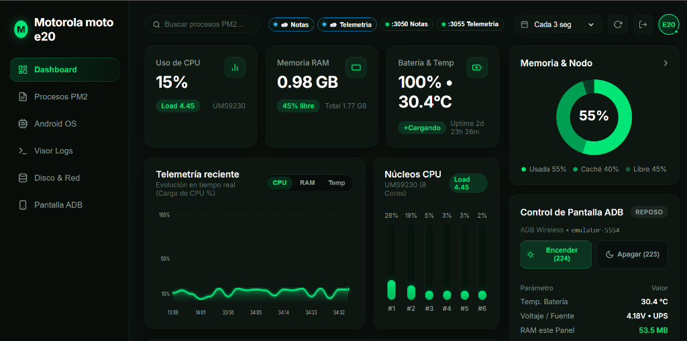
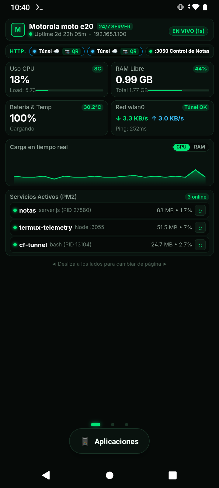
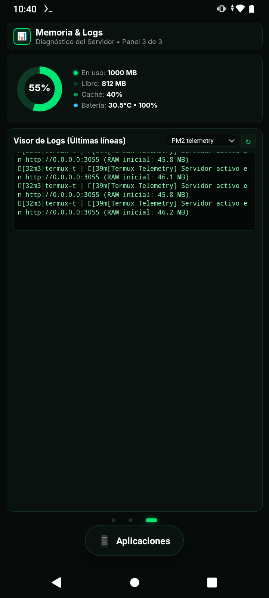

# Termux Telemetry

Micro-panel web y launcher de telemetría ultra-liviano para convertir un teléfono Android en un servidor doméstico monitoreable. Corre en **Termux** con Node.js + Express, y su interfaz está desarrollada con **Vue 3 + Vite** (diseño dark / verde esmeralda, PWA, y responsive para PC, tablet y móvil).

   

---

## Capturas de pantalla

### Dashboard Web (PC / Navegador)



### Launcher en el Teléfono (Android)

<p align="center">
  
  &nbsp;&nbsp;
  
</p>

---

## Características

- **CPU**: uso total, carga media y gráfico de barras en tiempo real por núcleo.
- **RAM**: memoria usada, disponible y en caché (lectura de `/proc/meminfo`).
- **Batería y Temperatura**: nivel, temperatura en °C, voltaje y estado de carga continua.
- **Uptime**: tiempo de actividad del sistema Android y del propio proceso Node.js.
- **Procesos PM2**: monitor de procesos activos, memoria, CPU, reinicios y uptime.
- **Control de pantalla**: encender (`keyevent 224`) y suspender (`keyevent 223`) mediante ADB inalámbrico.
- **Detección de puertos y túneles**: autodetección de servicios HTTP locales y túneles de Cloudflare (`cloudflared`) con generación automática de códigos QR para acceso rápido desde otros dispositivos.
- **Ping en tiempo real a túneles**: diagnóstico de conectividad, latencia y código de estado HTTP.
- **Soporte PWA**: instalable como aplicación nativa en escritorio y móviles con Service Worker y Web App Manifest.
- **Launcher Kiosk para Android**: modo pantalla completa con navegación por gestos horizontales táctiles y consumo mínimo.

---

## Requisitos

### 1. En el dispositivo Android (dentro de Termux)

- **Node.js**: versión LTS (v18 o superior).
- **android-tools**: proporciona el binario `adb` para comunicación local.
- **Git**: para clonación y actualizaciones automáticas.
- **PM2**: para la gestión y persistencia del proceso en segundo plano.

Comando de instalación en Termux:

```bash
pkg update && pkg install nodejs-lts android-tools git
npm install -g pm2
```

> **¿Por qué `android-tools`?**  
> Instala el comando `adb` directamente en Termux. Esto permite que el servidor Node.js se comunique con el teléfono a través de `127.0.0.1:5555` con permisos de sistema (`uid=shell/2000`).  
> En Android 8+ (incluido Android 11 Go), SELinux bloquea a Termux el acceso directo a `/proc/stat` y `/sys/class/power_supply/battery`. A través de ADB local, el panel puede leer `dumpsys battery`, `dumpsys power` y encender o apagar la pantalla con `input keyevent` sin requerir root.

- **ADB inalámbrico activo**:
  Activa la depuración por Wi-Fi en Opciones de Desarrollador (o ejecuta una vez `adb tcpip 5555` desde una PC conectada por USB) y conecta Termux a sí mismo:
  ```bash
  adb connect 127.0.0.1:5555
  ```

### 2. En la PC (para desarrollo o compilación)

- **Node.js**: v18.0.0 o superior ([nodejs.org](https://nodejs.org/)).
- **npm**: incluido con Node.js.

---

## Instalación en Termux

```bash
git clone https://github.com/ever23/telemetria-termux-server.git
cd telemetria-termux-server
cp .env.example .env          # opcional: ajusta puerto / host ADB
npm install --omit=dev
chmod +x scripts/screen_control.sh
npm run set-password          # define la contraseña de acceso (recomendado)
pm2 start ecosystem.config.js
pm2 save
```

Abre en cualquier navegador de tu red: `http://<IP-del-teléfono>:3055`

> La carpeta `public/` ya viene compilada, no hace falta compilar el frontend en el teléfono.

---

## Control de acceso

El panel se protege con una contraseña única:

```bash
npm run set-password          # pide la contraseña (oculta) dos veces
pm2 restart termux-telemetry  # aplica el cambio
```

- En `.env` solo se guarda el hash (`AUTH_PASSWORD_HASH`), calculado con `scrypt` y un salt aleatorio. La contraseña en texto plano no se guarda en ningún sitio.
- Al iniciar sesión se entrega una cookie `HttpOnly` y `SameSite=Strict` firmada con HMAC (`SESSION_SECRET`, generado automáticamente).
- Si cambias la contraseña, se invalidan todas las sesiones activas.
- Tras 5 intentos fallidos, la IP queda temporalmente bloqueada.
- Sin contraseña configurada, el panel entra en modo de solo lectura y el control de pantalla permanece bloqueado.

---

## Configuración (.env)

Todas las variables son opcionales. Ver `.env.example`.

| Variable | Default | Descripción |
| --- | --- | --- |
| `PORT` | `3055` | Puerto HTTP del panel |
| `SSH_PORT` | `8022` | Puerto SSH mostrado en el panel |
| `ADB_HOST_LOCAL` | `127.0.0.1:5555` | Host ADB usado cuando corre en Termux |
| `ADB_HOST_REMOTE` | `127.0.0.1:5555` | Host ADB usado cuando corre en Windows (desarrollo) |
| `POWER_SOURCE` | `5V UPS` | Etiqueta de la fuente de energía |
| `HISTORY_MAX_POINTS` | `20` | Puntos guardados en el historial |
| `CACHE_TTL_MS` | `2000` | Caché de lecturas ADB |
| `AUTH_PASSWORD_HASH` | — | Hash de la contraseña (generado por `npm run set-password`) |
| `SESSION_SECRET` | *autogenerado* | Clave para firmar las cookies de sesión |
| `SESSION_DAYS` | `7` | Duración de la sesión |
| `DEVICE_NAME`, `SOC_NAME`, `OS_NAME`, `SERVER_IP`, `TERMUX_USER`, `TUNNEL_URL` | *autodetectado* | Sobrescriben la autodetección |

---

## Desarrollo en PC

```bash
npm install
npm --prefix frontend install

npm run dev                     # backend en :3055
npm --prefix frontend run dev   # Vite en :5173 con proxy /api → :3055
npm run build:ui                # compila el frontend hacia public/
```

En Windows puedes apuntar al ADB del teléfono definiendo `ADB_HOST_REMOTE=<IP-del-teléfono>:5555` en `.env`. Sin conexión ADB, el backend utiliza valores simulados para que la interfaz continúe siendo navegable.

---

## Licencia

MIT
